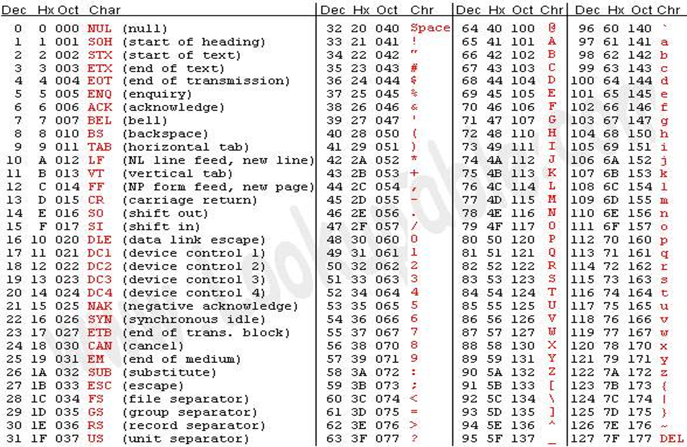

先特殊情况，再一般
浮点数——0 +0 （细节）
判断输入数据正确与否
自然语言表达式与电脑不相同；
在a《B《c的式子中a<b 输出的是0，1
布尔运算符号
&&（与 ）短路性   ||（或）   ！（非）  ^(亦或（相同为0，不同为1)
%取余（可以替代除法求素数）
非0整数为真，0为假（ ！2=0.！3=0 ， !0  =1）
高精度小数
fabs(delta)<eps 
const double eps =1e -8;
### 基础运算符号

++ 加1\
k++返回值为k；++k返回值为k+1\

m += 2 //m = m+2

*= 乘后赋值

# 第一次课
## 常识
1. 使用伪代码（先分析，再编写格式）
2. 缩短变量定义（用的时候再定义）~避免混淆
3. 效率高== 枚举少
0=false 1= true 
## 语法
if ,else if else if成立>>输出并结束，不成立

//单行注释

 /*多行注释*/\
 for (执行前运行;循环条件;执行（然后进行前一步）) *括号内1，2是循环前执行*\
continue:(结束本次循环，开始下一次)\
break：(结束整个循环)\
while （循环条件） //执行前判断//\
do{}while（） //先执行再判断// \
printf（）输出中间结果进行调实验（日志系统）\
&& ||的短路\
## 数组：

1. 使用for循环进行输入输出，比较
2. 数组复制memcpy（复制到b，从 m复制，长度）
3. 数组溢出(防止)
4. 访问超界
5. 初始化int a[n] = {1}//除开n以外其他元素均为0
6. 

# 第二次课
## 常识
1. **复杂度** 降低计算规模（斐波拉契递归or调用）

2. 矩阵{f(n-1) f(n)} (0 1)
                     (1 1)
3. a^n的运算：  for；线性复杂度；   二分；对数形式的复杂度
4. 做之前先检查行不行（）

\t制表

## 算法
循环的代价：速度慢

## 语法
scanf原理：\
按照格式串指定的格式进行扫描，匹配上就读入，匹配不上停止，自动跳空格和制表符\
返回值：正确读入的域个数\

### 重定向输入输出
freopen("in.txt","r",stdin);
输入重定向
freopen("out.txt","w",stdout)

# 第三次课
## 作业评讲
## bool标志元素的使用
 
## 数组补充
1. 字符数组
    char  s[100];//字符（不跳过空格，回车）
        char c;
        字符常量使用单引号'' \' 
        'd' ==100
        小写改大写printf("%c\n", c- 'a'+'A')
        putchar()\
        
        getchar()\ 
2. 字符串：以元素0（'\0'）结尾的字符数组
PS:0(asc2码null 0 )  !=  '0'(asc2码32)
字符串include<string.h>

    %s遇到空白字符停下  strlen() 
    
    fgets(输入到，长度，来源):读入1行字符 然后把读入的最终值给

strrve（）字符串反转
'\0'  '\t'

'\031'(8进制)
'\X3A'(16进制)
':'  58  都是：

常用字符串处理函数
strcmp 比较
strlen()括号里面是数组名a/b（当数值为0（不是符号0）时候结束计数）
strcpy
strcat
strchr查找
sprintf
sscanf
atoi/atof

# 第四次课
## 作业评讲 
## 常识
-o2 2级优化，编译器使用
## 字符串【以0结尾的字符数组】
学习2种东西：状态机（状态转换）+模式匹配；\

状态机:使用一个变量来确定某函数的状态，

模式匹配：在输入里面一直寻找你需要的特定模式，匹配到后再进行处理。\

处理字符串，不要一个一个读，整行读入之后处理数组\
方法for（int i= 0 ； s[i]!= '\0';i++)\
fgets性能>>getchar：EOF后返回值是-1\
putchar  getchar

## 重要思想
解耦：分离处理逻辑和数据\
常量数组：不用规定长度，可用于简化代码

# 第五次课
## 代码评讲
*优化意识：让代码尽可能优化。循环尽可能少。*
### 对于循环的优化：
1. 用数学方法把循环所得值直接算出来
2. 判断循环条件：尽可能压缩次数
## 算法
### 牛顿拉弗森迭代法
求 √a：先取一个正数 x₀ 作为初始猜测。
xₙ₊₁ = (xₙ + a ÷ xₙ) ÷ 2
重复计算，直到新旧 x 很接近；此时 xₙ₊₁ ≈ √a（a ≥ 0）。
### 二分查找
适用于已经按从小到大排好序的数据。设查找范围是 [左边界, 右边界]：
中间位置 = (左边界 + 右边界) ÷ 2
目标 = 中间位置的数 → 找到；目标 > 中间位置的数 → 左边界 = 中间位置 + 1
目标 < 中间位置的数 → 右边界 = 中间位置 - 1；重复查找，直到找到目标或范围为空。

